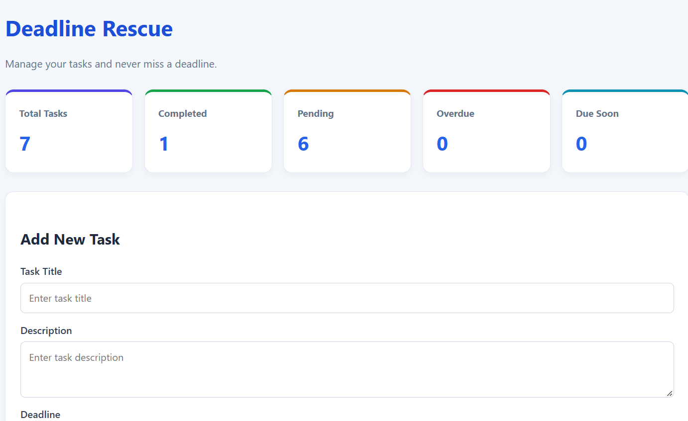

# Deadline Rescue – Task Management Application

Deadline Rescue is a task management web application built with Java and Spring Boot. It helps users organize tasks, manage deadlines, track completion status, and identify overdue tasks.

## Screenshots

### Dashboard



## Features

- Add new tasks with descriptions, deadlines, and priorities
- Edit existing tasks
- Mark tasks as completed or reopen them
- Delete tasks
- Search tasks by title or description
- Filter tasks by status, including pending, completed, overdue, and due soon
- View dashboard statistics
- See visual warnings for approaching deadlines

## Technologies Used

- **Language:** Java
- **Backend:** Spring Boot, Spring MVC
- **Frontend:** HTML, CSS, Thymeleaf
- **Database:** MySQL
- **Database Integration:** Spring Data JPA, Hibernate
- **Build Tool:** Maven

## Prerequisites

Install the following before running the application:

- Java Development Kit (JDK)
- MySQL Server
- Git (optional, for version control)

## How to Run

1. Clone or download this repository.
2. Create a MySQL database named `java_project`.
3. Configure your database connection in `src/main/resources/application.properties` using your own local database credentials.
4. Open PowerShell in the project directory.
5. Build the application:

   ```powershell
   .\mvnw.cmd clean package
   ```

6. Run the generated application:

   ```powershell
   java -jar .\target\deadline-rescue-0.0.1-SNAPSHOT.jar
   ```

7. Open your browser and visit [http://localhost:8080](http://localhost:8080).

## Learning Outcomes

This project demonstrates practical experience with Java, Spring Boot, MVC architecture, database integration, CRUD operations, server-side rendering, and Maven-based application builds.

## Future Enhancements

- User registration and login
- Email or browser notifications for upcoming deadlines
- Pagination and improved task organization
- Deployment to a cloud platform

## Author

Computer Science and Engineering Student